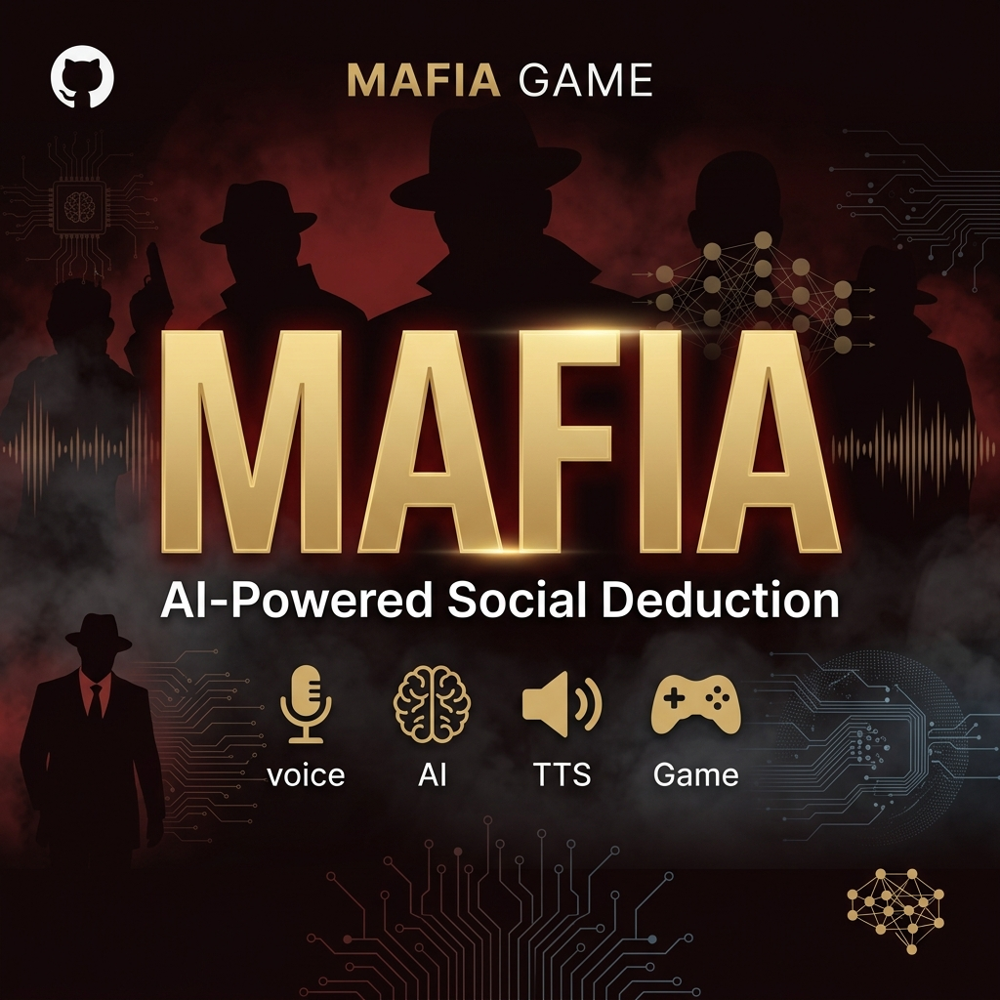

<p align="center">
  
</p>

<h1 align="center">🎩 المافيا — مدينة لا تنام</h1>

<p align="center">
  <b>An Arabic noir social-deduction game.</b><br>
  Play against smart bots in your browser, or with friends online — with optional AI voice replies.
</p>

<p align="center">
  
  
  
  
  
</p>

---

## ⚡ التشغيل السريع

```bash
npm install
npm run dev
```

- افتح **http://localhost:3000** — "العب الآن ضد البوتات" يشتغل فوراً.
- `npm run dev` يشغّل الموقع **و** سيرفر اللعب الأونلاين (المنفذ 3002) مع بعض.
- للعب مع أصحابك على نفس الشبكة: خلهم يفتحون رابط **Network** اللي يطلع في الطرفية (مثل `http://192.168.1.20:3000`). أول مرة قد يسألك ويندوز عن الجدار الناري — اسمح له.

## ✨ What's in the box

| | |
|:--|:--|
| 🃏 **9 roles** | Mafia, Godfather (reads innocent, decides the kill), Citizen, Doctor (no same target twice), Detective, Bodyguard (dies in your place), Vigilante (one bullet), Mayor (double vote), Jester (wins if lynched) |
| 🌐 **Online multiplayer** | Room codes + share links, host controls (roles, timers, kick, fill with bots), reconnect after a refresh, server-authoritative — each client only receives what that player may know |
| 🤖 **Bots that think** | Per-bot suspicion that reacts to accusations in chat, voting patterns, lynch results and detective findings. Detective bots announce mafia they find; mafia bots coordinate and frame their accusers |
| 💬 **Three chat channels** | Public table chat (only the speaker talks during testimony), a private mafia channel at night, and a channel for the dead |
| 🎨 **Noir Arabic art direction** | Aref Ruqaa / Reem Kufi / IBM Plex Arabic (self-hosted), rain, film grain, the city newspaper, role cards with art-deco medallions |
| 🎬 **Cinematic, interactive table** | Venetian blinds + lightning at nightfall, a spinning newspaper typed out at dawn with a gunshot and screen-shake, a drum-roll and gavel slam at the verdict, poker chips flying to whoever gets voted, a flashlight that follows your cursor at night, role-themed target reticles, speech bubbles over the seats, parallax backgrounds, a deck that fans out to deal your card |
| 🎵 **Sound design** | 35 CC0 sounds (Kenney + a noir SFX kit): rain and noir beds that crossfade between day and night, a heartbeat that speeds up as the vote runs out, typewriter, church bell, card shuffles, chips, gavel, thunder |
| 🏆 **Progression** | Stats per role, 12 achievements, match history, gems, and a cosmetic store (card backs, avatar frames, titles) — saved in the browser |
| 🎙️ **AI voice (optional)** | In bot games, hold to talk; Whisper → LLM → cloned TTS answers as a bot (see `game_backend/`) |
| 📱 **Responsive** | Works on phones in portrait |

## 🏗 Architecture

```
src/game/          Pure TypeScript — no React, shared by browser and server
  rules.ts         Deck, votes, night resolution, win conditions
  bots.ts          Bot memory, suspicion, decisions, dialogue
  room.ts          Room: the authoritative state machine (phases, timers,
                   chat channels, bots) + viewFor(playerId) per-player views
  protocol.ts      Client ⇄ server messages
server/index.ts    Node WebSocket server hosting many Rooms (npm run server)
src/client/        Transports (local Room in the tab / online socket),
                   game store, profile (localStorage), audio
src/components/    UI — play/ (Lobby, Table, Seat, ChatBox, GameOver)
src/app/           Pages: / · /play · /profile · /store · /rules
game_backend/      Optional FastAPI voice pipeline (Whisper → Ollama → TTS)
```

A local game and an online game run **the same `Room` class** — locally it
ticks in your tab, online it ticks on the server. The UI only ever renders a
`PlayerView`, so hidden roles never reach the wrong browser.

Round flow: `lobby → reveal → night → morning → testimony → discussion → voting → verdict → night …`

## 🧪 Quality

```bash
npm test           # rules + room state machine (36 tests, incl. 12 full simulated games)
npm run lint
npm run typecheck
npm run build

cd game_backend && python -m pytest tests   # voice backend protocol tests
```

## 🚀 Deploying online

The web app and the game server are separate processes:

1. **Game server** — any Node host with WebSockets (Render, Fly.io, Railway, a VPS):
   `npm ci && npm run server` (uses `PORT`, default 3002). Health check: `/health`.
2. **Web app** — Vercel or any Next.js host, with
   `NEXT_PUBLIC_GAME_SERVER_URL=wss://your-server-host`.

Or run both in one container: `docker build -t mafia . && docker run -p 3000:3000 -p 3002:3002 mafia`.

## 🎙️ Optional: AI voice backend

```bash
cd game_backend
python -m venv venv && venv\Scripts\activate     # Windows
pip install -r requirements.txt
cp .env.example .env
python main.py                                   # ws://localhost:8000/ws/audio
```

Then in the game: ⚙️ Settings → "ردود صوتية بالذكاء الاصطناعي". Requires
[Ollama](https://ollama.com) and, for cloned voices, the Chatterbox TTS studio
(see `game_backend/.env.example`).

## 🙏 Credits

Icons: [game-icons.net](https://game-icons.net) (Lorc, Delapouite & contributors) — CC BY 3.0.
Sounds: [Kenney](https://kenney.nl) packs and the [WHODUNIT?! noir SFX kit](https://github.com/GeorgeShani/whodunit) — CC0, via [CC0-Public-Domain-Sounds](https://github.com/lavenderdotpet/CC0-Public-Domain-Sounds).
Full list in-game at `/credits`.

## 📄 License

MIT — see [LICENSE](LICENSE).

<p align="center"><sub>Built by <a href="https://github.com/ALM3SHI">@ALM3SHI</a> · المافيا لا تنام 🎭</sub></p>
