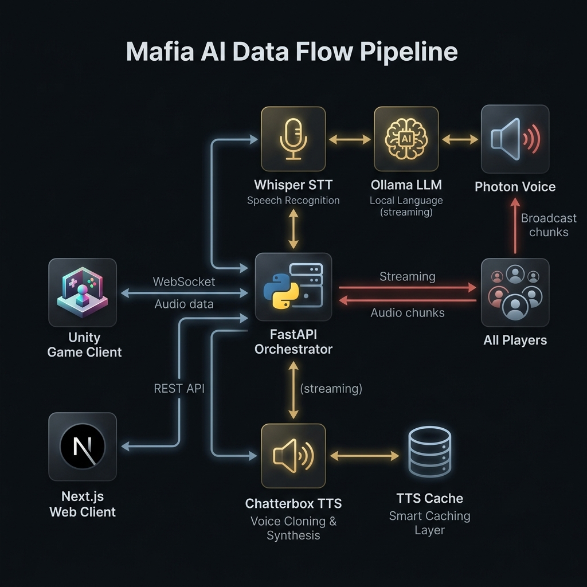
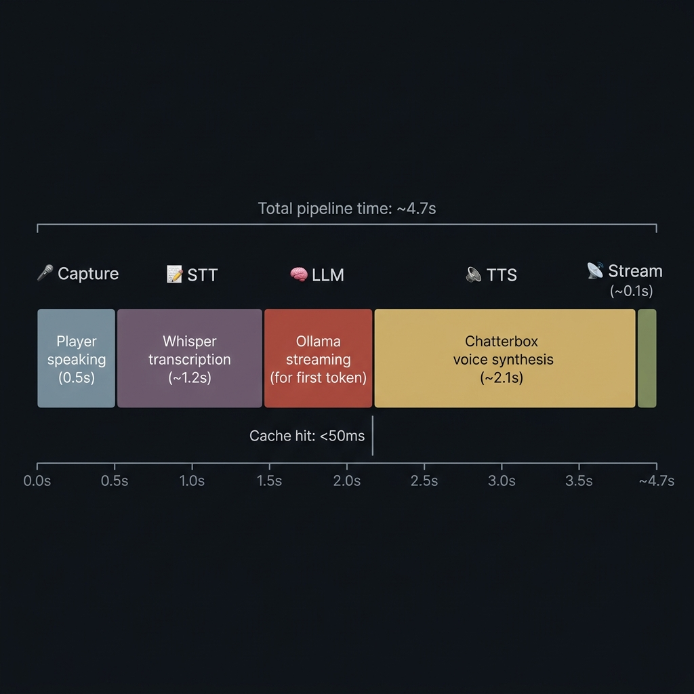

<p align="center">
  
</p>

<h1 align="center">🎭 Mafia Game</h1>

<p align="center">
  <b>Intelligent Multi-Agent Mafia Game system powered by LLMs</b><br>
  <sub>Real-time voice AI · Sentence-level streaming · Voice cloning · Low-latency pipeline</sub>
</p>

<p align="center">
  <a href="#-quick-start"></a>
  <a href="#-architecture"></a>
  <a href="#-tech-stack"></a>
  <a href="LICENSE"></a>
</p>

<p align="center">
  
  
  
  
  
  
  
  
</p>

---

## 📌 What is This?

**Mafia Game** is a fully voice-driven AI social deduction game where human players interact with intelligent AI bots through natural speech — in **Arabic**. The system captures your voice, understands what you said, generates a contextually aware response in Saudi dialect, and speaks it back to you in a **cloned voice** — all in under 5 seconds.

This is not a chatbot. This is a full-stack multiplayer game engine with:

- 🎤 **Real-time voice pipeline** — speak naturally, hear AI bots respond in voice
- 🧠 **Multi-agent LLM system** — each bot has its own role, strategy, and personality
- 🔊 **Voice cloning** — bots speak in distinct cloned voices via Chatterbox Multilingual
- ⚡ **Sentence-level streaming** — first audio chunk plays in ~3s, rest streams underneath
- 🎮 **Dual-client architecture** — both web (Next.js) and 3D (Unity) clients supported

<br>

## 🏗 Architecture

<p align="center">
  
</p>

### How It Works — The Complete Pipeline

```
  ┌──────────────┐         WebSocket          ┌──────────────────────┐
  │  Unity 3D    │◄────── Audio Chunks ◄──────│                      │
  │  Client      │─────── WAV Audio ─────────►│   FastAPI Backend    │
  │              │                             │   (Orchestrator)     │
  └──────────────┘                             │                      │
                                               │  ┌────────────────┐ │
  ┌──────────────┐         WebSocket          │  │  Whisper STT   │ │
  │  Next.js     │◄────── Audio Chunks ◄──────│  │  (Arabic, ar)  │ │
  │  Web Client  │─────── WebM Audio ─────────►│  └───────┬────────┘ │
  │              │                             │          ▼          │
  └──────────────┘                             │  ┌────────────────┐ │
                                               │  │  Ollama LLM    │ │
                                               │  │  (Streaming)   │ │
                                               │  └───────┬────────┘ │
                                               │          ▼          │
                                               │  ┌────────────────┐ │
                                               │  │  Chatterbox    │ │
                                               │  │  MTL TTS       │ │
                                               │  │  (Voice Clone) │ │
                                               │  └───────┬────────┘ │
                                               │          ▼          │
                                               │  ┌────────────────┐ │
                                               │  │  TTS Cache     │ │
                                               │  │  (SHA-256 key) │ │
                                               │  └────────────────┘ │
                                               └──────────────────────┘
```

### Pipeline Stages

| Stage | Component | Time | Description |
|:---:|:---|:---:|:---|
| 🎤 | **Audio Capture** | ~0.5s | Player speaks via mic (push-to-talk or auto) |
| 📝 | **Whisper STT** | ~1.2s | Speech-to-text with Arabic tuning (beam=1, VAD filter) |
| 🧠 | **Ollama LLM** | ~0.8s | Streaming token generation with game context injection |
| 🔊 | **Chatterbox TTS** | ~2.1s | Voice-cloned speech synthesis per sentence |
| 📡 | **WebSocket Stream** | ~0.1s | Audio chunk delivery to client |
| | **Total (first audio)** | **~4.7s** | Cache hit: **< 50ms** ⚡ |

<p align="center">
  
</p>

> **💡 Key Insight:** The LLM response is split into sentences and each sentence is synthesized independently. The first audio chunk plays in ~3-5 seconds. By the time it finishes playing, subsequent chunks have already been generated — creating the perception of near-instant response.

<br>

## ✨ Key Features

<table>
<tr>
<td width="50%">

### 🎭 Intelligent AI Agents
- Dynamic system prompts with live game state
- Role-aware behavior (Mafia, Citizen, Doctor, Police...)
- Saudi Arabic dialect ("لهجة سعودية بيضاء")
- Short, provocative, in-character responses

</td>
<td width="50%">

### ⚡ Real-Time Voice Pipeline
- Sentence-level streaming (not wait-for-all)
- Sub-5s time-to-first-audio
- Disk-backed TTS cache (SHA-256 keyed)
- GPU → CPU graceful fallback

</td>
</tr>
<tr>
<td>

### 🔊 Voice Cloning
- Chatterbox Multilingual TTS engine
- Clone any voice from a 5-second sample
- Per-bot unique voice identity
- Gradio studio integration with VRAM preloading

</td>
<td>

### 🎮 Full Game Engine
- Complete Mafia game state machine
- 8 game phases: lobby → reveal → testimony → day → night → reaction → voting → game-over
- 10+ configurable roles (Doctor, Detective, Witch, Jester, Serial Killer...)
- In-game store, card collection, profile system

</td>
</tr>
<tr>
<td>

### 🌐 Dual-Client Architecture
- **Next.js 16** web client (React 19, TypeScript)
- **Unity C#** 3D client with Photon Voice
- Same backend, same WebSocket protocol
- Arabic RTL layout with gothic arcade UI

</td>
<td>

### 🛡️ Production-Ready
- Bearer token authentication
- Health check endpoints
- Detailed timing telemetry per turn
- Cloud-portable (all config via env vars)
- Zero hardcoded paths

</td>
</tr>
</table>

<br>

## 🔧 Tech Stack

### AI / ML Pipeline
| Component | Technology | Purpose |
|:---|:---|:---|
| Speech-to-Text | **Faster Whisper** (small model) | Arabic transcription with VAD |
| Language Model | **Ollama** (Qwen 2.5 / Aya) | Streaming conversational AI |
| Text-to-Speech | **Chatterbox Multilingual** | Arabic voice cloning & synthesis |
| TTS Interface | **Gradio Client** | Remote GPU inference bridge |

### Frontend
| Component | Technology | Purpose |
|:---|:---|:---|
| Framework | **Next.js 16** | App Router, RSC |
| UI Library | **React 19** | Component architecture |
| Language | **TypeScript 5** | Type safety |
| Styling | **Tailwind CSS 4** | Dark gothic arcade theme |
| Animation | **Framer Motion 12** | Smooth micro-animations |
| State | **Zustand 5** | Game state management |
| Icons | **Lucide React** | UI iconography |
| Backend-as-a-Service | **Supabase** | Auth, realtime, database |

### Backend
| Component | Technology | Purpose |
|:---|:---|:---|
| Framework | **FastAPI** | Async WebSocket server |
| Server | **Uvicorn** | ASGI production server |
| Protocol | **WebSocket** | Bidirectional audio streaming |

### Unity Client
| Component | Technology | Purpose |
|:---|:---|:---|
| Engine | **Unity (C#)** | 3D game client |
| Networking | **NativeWebSocket** | WebSocket bridge to backend |
| Multiplayer | **Photon Voice** | Real-time voice relay |
| Audio | **Custom WAV Utility** | PCM16/Float32 encode/decode |
| Visuals | **RMS Lip Sync** | Amplitude-driven mouth animation |

<br>

## 📁 Project Structure

```
mafia-game/
│
├── 📱 src/                          # Next.js Web Client
│   ├── app/
│   │   ├── page.tsx                 # Landing page (arcade UI)
│   │   ├── lobby/page.tsx           # Game lobby & setup
│   │   ├── game/page.tsx            # Main gameplay screen
│   │   ├── store/page.tsx           # In-game store
│   │   ├── layout.tsx               # RTL Arabic layout + fonts
│   │   └── globals.css              # Design system & tokens
│   ├── components/
│   │   ├── game/                    # Card, PhaseBadge
│   │   ├── shared/                  # Chat, CRTOverlay
│   │   └── ui/                      # GothicButton
│   ├── hooks/
│   │   ├── useVoiceSocket.ts        # WebSocket voice bridge
│   │   └── useSound.ts             # SFX manager
│   ├── store/
│   │   └── useGameStore.ts          # Zustand game state machine
│   └── lib/
│       ├── game-logic.ts            # Role distribution, win conditions
│       └── supabase.ts              # Database client
│
├── 🧠 game_backend/                 # FastAPI AI Backend
│   ├── main.py                      # Orchestrator (STT→LLM→TTS pipeline)
│   ├── config.py                    # Centralized env-based configuration
│   ├── tts_cache.py                 # Disk-backed TTS cache (SHA-256)
│   ├── test_latency.py              # Pipeline benchmark tool
│   ├── .env.example                 # Environment template
│   ├── requirements.txt             # Python dependencies
│   ├── scripts/
│   │   ├── prepare_voice_sample.py  # Audio format conversion
│   │   └── make_test_clip.py        # Test clip generator
│   └── data/
│       ├── clones/                  # Voice clone references
│       └── tts_cache/               # Cached TTS output
│
├── 🎮 unity_scripts/                # Unity 3D Client Scripts
│   ├── AIBridgeClient.cs            # WebSocket bridge (singleton)
│   ├── AudioPlaybackQueue.cs        # Gapless sentence queue
│   ├── MicRecorder.cs               # Push-to-talk recorder
│   ├── LipSync.cs                   # Amplitude-driven lip sync
│   └── WavUtility.cs                # WAV encode/decode
│
├── 🧪 ai_poc/                       # Initial Proof of Concept
│   ├── poc.py                       # CLI pipeline prototype
│   └── requirements.txt             # POC dependencies
│
├── 🎨 public/                       # Static Assets
│   ├── cards/                       # Role card artwork
│   ├── ui/                          # Background images
│   └── sounds/                      # 18 game SFX files
│
└── 📄 Configuration
    ├── package.json                 # Node.js dependencies
    ├── next.config.ts               # Next.js optimization config
    ├── tsconfig.json                # TypeScript config
    └── .gitignore                   # Comprehensive ignore rules
```

<br>

## 🚀 Quick Start

### Prerequisites

| Requirement | Version | Purpose |
|:---|:---|:---|
| **Node.js** | 18+ | Next.js web client |
| **Python** | 3.10+ | AI backend |
| **Ollama** | Latest | Local LLM inference |
| **GPU** (recommended) | NVIDIA RTX 3050+ | TTS voice synthesis |

### 1️⃣ Clone the Repository

```bash
git clone https://github.com/ALM3SHI/mafia-game.git
cd mafia-game
```

### 2️⃣ Start the AI Backend

```bash
# Navigate to the backend
cd game_backend

# Create virtual environment
python -m venv venv
venv\Scripts\activate          # Windows
# source venv/bin/activate     # macOS/Linux

# Install dependencies
pip install -r requirements.txt

# Configure environment
cp .env.example .env
# Edit .env with your settings (Ollama URL, TTS studio URL, etc.)

# Start the server
python main.py
```

> The backend will start on `http://0.0.0.0:8000` with WebSocket endpoints at `/ws/audio` and `/ws/clone`.

### 3️⃣ Start Ollama (LLM)

```bash
# Pull the Arabic-capable model
ollama pull aya

# Ollama should be running on port 11434
ollama serve
```

### 4️⃣ Start the Web Client

```bash
# From the project root
npm install
npm run dev
```

> Open [http://localhost:3000](http://localhost:3000) to see the game UI.

### 5️⃣ (Optional) TTS Voice Cloning

To enable voice cloning, you need the [Chatterbox Multilingual TTS](https://github.com/resemble-ai/chatterbox) studio running:

```bash
# The TTS studio should be accessible at http://127.0.0.1:7860/
# Configure in game_backend/.env:
TTS_BASE_URL=http://127.0.0.1:7860/
TTS_DEFAULT_REF_AUDIO=voice_sample.wav
```

<br>

## ⚙️ Configuration

All configuration is managed through environment variables for cloud portability. See [`game_backend/.env.example`](game_backend/.env.example) for the complete reference.

### Key Settings

| Variable | Default | Description |
|:---|:---|:---|
| `OLLAMA_MODEL` | `aya` | LLM model for game dialogue |
| `WHISPER_MODEL` | `small` | STT model size (tiny/base/small/medium/large-v3) |
| `WHISPER_DEVICE` | `cpu` | STT device (`cpu` or `cuda`) |
| `TTS_ENGINE` | `Chatterbox Multilingual` | Voice synthesis engine |
| `TTS_LANGUAGE` | `ar` | TTS language code |
| `MAFIA_API_KEY` | *(empty)* | Bearer token for auth |

<br>

## 🧪 Performance Testing

The project includes a built-in latency benchmark:

```bash
cd game_backend
python test_latency.py --runs 5 --audio voice_sample_5s.wav
```

This measures:
- **TTFA** (Time-to-First-Audio) — the critical UX metric
- Per-stage breakdown: STT, LLM, TTS generation
- Cache hit rates
- p50/p95/min/max statistics

<br>

## 🎮 Game Features

### Roles System
| Role | Team | Ability |
|:---:|:---|:---|
| 🔫 | **Mafia** | Kills one player each night |
| 👤 | **Citizen** | Votes during the day |
| 🏥 | **Doctor** | Saves one player each night (available at 6+ players) |
| 🔍 | **Detective** | Investigates one player each night (available at 5+ players) |
| 🧙 | **Witch** | One-time kill or save potion (available at 8+ players) |
| 🛡️ | **Bodyguard** | Protects a player, dies if target is attacked |
| 👑 | **Mayor** | Vote counts as double |
| 👻 | **Medium** | Can communicate with dead players |
| 🃏 | **Jester** | Wins if voted out by town |
| 🔪 | **Serial Killer** | Independent killer, kills each night |
| ⚖️ | **Executioner** | Wins if their target is voted out |

### Game Phases
```
lobby → reveal → testimony → day → night → reaction → voting → game-over
                    ↑                                        │
                    └────────────────────────────────────────┘
```

<br>

## 🗺️ Roadmap

- [x] Core voice pipeline (STT → LLM → TTS)
- [x] Sentence-level streaming
- [x] Voice cloning integration
- [x] TTS disk caching
- [x] Next.js web client with full game UI
- [x] Unity C# client bridge
- [x] Zustand game state machine
- [x] Performance benchmarking tool
- [ ] Multiplayer via Supabase Realtime
- [ ] Cloud GPU deployment (RunPod/Modal)
- [ ] Mobile-responsive web UI
- [ ] Additional LLM models & personalities
- [ ] Spectator mode with live audio

<br>

## 🤝 Contributing

Contributions are welcome! Please see [CONTRIBUTING.md](CONTRIBUTING.md) for guidelines.

1. **Fork** the repository
2. **Create** a feature branch (`git checkout -b feature/amazing-feature`)
3. **Commit** your changes (`git commit -m 'Add amazing feature'`)
4. **Push** to the branch (`git push origin feature/amazing-feature`)
5. **Open** a Pull Request

<br>

## 📄 License

This project is licensed under the **MIT License** — see the [LICENSE](LICENSE) file for details.

<br>

---

<p align="center">
  <sub>Built with ❤️ and ☕ by <a href="https://github.com/ALM3SHI">@ALM3SHI</a></sub><br>
  <sub>المافيا لا تنام 🎭</sub>
</p>
